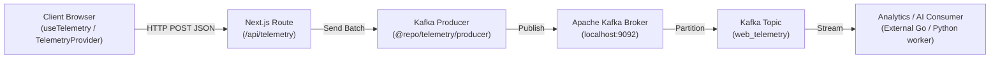

# 📡 Kafka Telemetry Library (`@repo/telemetry`)

[](https://kafka.apache.org/)
[](https://kafka.js.org/)
[](https://www.docker.com/)

The `@repo/telemetry` package provides event streaming and user behavior telemetry pipelines for StudyHub and TestHub backed by **Apache Kafka**. It supplies client-side tracking hooks, event serialization, and a resilient server-side Kafka producer.

---

## ⚡ Architecture Overview



---

## 📋 Tracked Event Types (`event-types.ts`)

| Event Type | Description |
| :--- | :--- |
| `PAGE_VIEW` | Page visit with path, referrer, and user session ID. |
| `EXAM_STARTED` | Triggered when a student begins a mock test. |
| `QUESTION_ANSWERED` | Triggered when an MCQ or numerical response is selected. |
| `QUESTION_REVIEW_MARKED` | Flagged question for review in CBT palette. |
| `DIAGRAM_CANVAS_STROKE` | Student sketch or scratchpad interaction on diagram canvas. |
| `AI_CHAT_MESSAGE` | Query submitted to the embedded study chatbot. |
| `CITATION_CLICKED` | Student clicked on `[Page X]` citation to jump to textbook source. |

---

## 📦 Usage Examples

### 1. In React Components

```tsx
import { useTelemetry } from "@repo/telemetry/hooks";

export function QuestionOptionButton({ optionId }: { optionId: string }) {
  const { trackEvent } = useTelemetry();

  const handleSelect = () => {
    trackEvent("QUESTION_ANSWERED", {
      selectedOptionId: optionId,
      timestamp: Date.now(),
    });
  };

  return <button onClick={handleSelect}>Select Option</button>;
}
```

### 2. In Server-Side API Handlers (`producer.ts`)

```typescript
import { sendTelemetryBatch } from "@repo/telemetry/producer";

export async function POST(request: Request) {
  const events = await request.json();
  await sendTelemetryBatch(events);
  return Response.json({ success: true });
}
```

---

## 🐳 Starting Kafka Locally

Start Kafka and ZooKeeper using the monorepo root Docker Compose:

```bash
docker compose up -d zookeeper kafka
```

To view incoming events in real time from the terminal:

```bash
docker exec -it studyhub_kafka kafka-console-consumer --bootstrap-server localhost:9092 --topic web_telemetry --from-beginning
```

