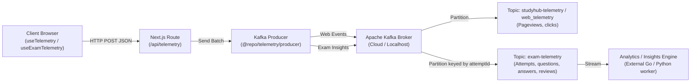

# 📡 Kafka Telemetry Library (`@repo/telemetry`)

[](https://kafka.apache.org/)
[](https://kafka.js.org/)
[](https://www.docker.com/)

The `@repo/telemetry` package provides event streaming and user behavior telemetry pipelines for StudyHub and TestHub backed by **Apache Kafka**. It supplies client-side tracking hooks, event serialization, and a resilient server-side Kafka producer.

---

## ⚡ Architecture Overview



---

## 📋 Tracked Event Types (`event-types.ts`)

| Event Type | Topic | Key Insight Data | Description |
| :--- | :--- | :--- | :--- |
| `page_view` | `web_telemetry` | `user_id`, `session_id`, `page_url` | Page visit with path, referrer, and user session ID. |
| `click` | `web_telemetry` | `user_id`, `metadata.tagName`, `metadata.id` | Global client UI click event. |
| `attempt_started` | `exam-telemetry` | `user_id`, `attempt_id`, `paper_id` | Triggered when candidate initiates an exam test session. |
| `question_viewed` | `exam-telemetry` | `user_id`, `attempt_id`, `question_id`, `sequenceNum` | Candidate navigated to and viewed a question. |
| `answer_selected` | `exam-telemetry` | `user_id`, `attempt_id`, `question_id`, `option_id` | MCQ option or numerical response selected. |
| `answer_changed` | `exam-telemetry` | `user_id`, `attempt_id`, `question_id`, `payload.previousOptionId`, `payload.newOptionId` | Candidate updated or changed their answer. |
| `answer_cleared` | `exam-telemetry` | `user_id`, `attempt_id`, `question_id` | Response cleared by candidate. |
| `question_navigated` | `exam-telemetry` | `user_id`, `attempt_id`, `payload.fromQuestionId`, `payload.toQuestionId` | Navigation transition between questions. |
| `marked_for_review` | `exam-telemetry` | `user_id`, `attempt_id`, `question_id` | Flagged question for review in CBT palette. |
| `focus_changed` | `exam-telemetry` | `user_id`, `attempt_id`, `payload.reason`, `payload.violationCount` | Proctoring violation or window tab switch. |
| `attempt_submitted` | `exam-telemetry` | `user_id`, `attempt_id`, `paper_id`, `timeSpentSeconds`, `answeredCount` | Final or auto-submission of exam attempt. |

---

## 📦 Usage Examples

### 1. In Exam CBT Components (`useExamTelemetry`)

```tsx
import { useExamTelemetry } from "@repo/telemetry/hooks";

export function ExamQuestionPalette({ paperId, attemptId, userId }: { paperId: string; attemptId: string; userId?: string }) {
  const { trackQuestionViewed, trackAnswerSelected } = useExamTelemetry({
    paperId,
    attemptId,
    userId,
  });

  const handleSelectOption = (questionId: string, optionId: string) => {
    trackAnswerSelected(questionId, optionId, {
      subject: "Physics",
      topic: "Mechanics",
    });
  };

  return <button onClick={() => handleSelectOption("q_1", "opt_b")}>Select Option B</button>;
}
```

  return <button onClick={handleSelect}>Select Option</button>;
}
```

### 2. In Server-Side API Handlers (`producer.ts`)

```typescript
import { sendTelemetryBatch } from "@repo/telemetry/producer";

export async function POST(request: Request) {
  const events = await request.json();
  await sendTelemetryBatch(events);
  return Response.json({ success: true });
}
```

---

## 🐳 Starting Kafka Locally

Start Kafka and ZooKeeper using the monorepo root Docker Compose:

```bash
docker compose up -d zookeeper kafka
```

To view incoming events in real time from the terminal:

```bash
docker exec -it studyhub_kafka kafka-console-consumer --bootstrap-server localhost:9092 --topic web_telemetry --from-beginning
```

